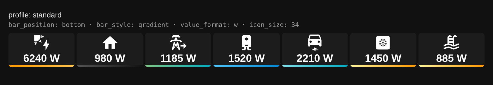
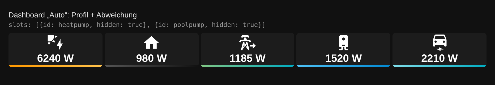
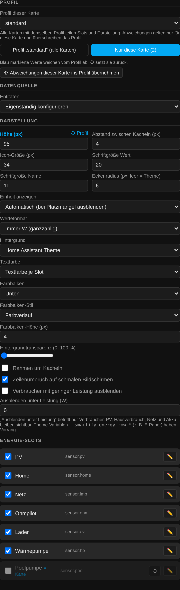
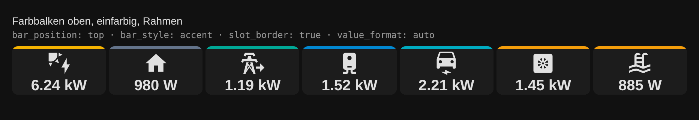
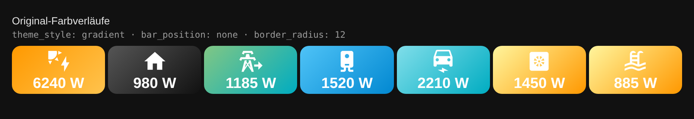
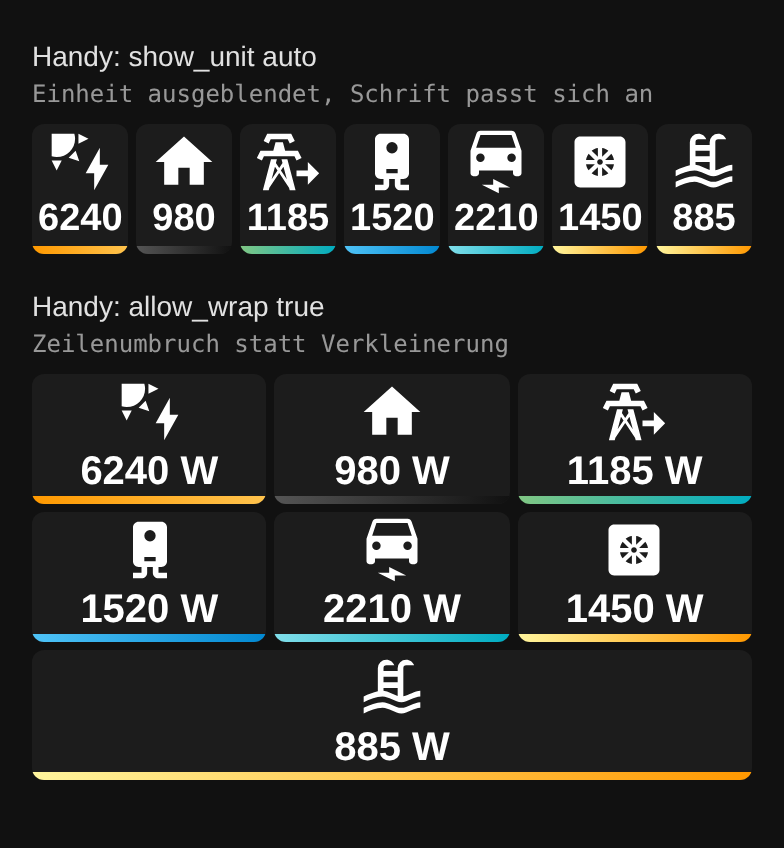
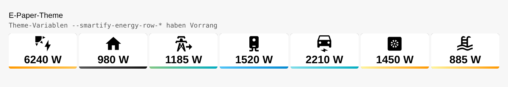

# Smartify Energy Row Card

Eigenständige Home-Assistant-Integration mit kompakter Energieleiste und visueller Konfiguration. **Kein Zugangstoken im Frontend**.



## Installation (HACS)

1. In HACS unter benutzerdefinierte Repositories `https://github.com/smartify-your-home/smartify-row-card` als **Integration** hinzufügen.
2. Installieren, Home Assistant neu starten.
3. Unter **Einstellungen → Geräte & Dienste** die Integration **Smartify Energy Row Card** einmalig hinzufügen.
4. In einem Dashboard `custom:smartify-energy-row-card` als Karte hinzufügen. Die JS-Ressource wird im Lovelace-Storage-Modus automatisch registriert.

Bei YAML-Lovelace-Ressourcen diese URL als JavaScript-Modul eintragen:
`/smartify_energy_row_card/smartify-energy-row-card.js?v=2.1.0`.

## Profile: einmal einstellen, überall verwenden (2.1.0)

Slots (Entitäten, Namen, Icons, Grenzwerte) **und** Darstellung werden in einem **Profil** zentral in Home Assistant gespeichert. Alle Karten mit demselben Profil übernehmen Änderungen sofort – auf allen Dashboards und Geräten. Wo ein Dashboard anders aussehen soll, setzt du nur die Abweichung direkt in der Karte.

```yaml
# überall gleich
type: custom:smartify-energy-row-card
profile: standard
```

```yaml
# gleiche Werte, nur höher und ohne Poolpumpe
type: custom:smartify-energy-row-card
profile: standard
height: 95
slots:
  - id: poolpump
    hidden: true
```

Reihenfolge der Auflösung: **Standardwerte → Profil → Karte**. In `slots:` der Karte reicht die `id` plus die Felder, die abweichen sollen (z. B. `hidden`, `label`, `entity`, `hide_below`). Alles andere kommt aus dem Profil.



Im Karteneditor wählst du oben das Profil und schaltest um zwischen **Profil „…“ (alle Karten)** und **Nur diese Karte**. Abweichungen sind blau markiert, **↺** setzt sie auf den Profilwert zurück, und **Abweichungen dieser Karte ins Profil übernehmen** macht eine Karteneinstellung zum neuen Standard. Weitere Profile (z. B. `kompakt`, `tablet`) legst du über **＋ Neues Profil** an.



Profile lassen sich auch per Dienst (nur Administratoren) setzen, z. B. aus Skripten oder Automationen:

```yaml
action: smartify_energy_row_card.set_profile
data:
  name: standard
  settings:
    height: 65
    icon_size: 34
    bar_position: bottom
  slots:
    - id: pv
      entity: sensor.pv_leistung
    - id: poolpump
      entity: sensor.poolpumpe_leistung
      entity_activity: switch.poolpumpe
```

`smartify_energy_row_card.delete_profile` löscht ein Profil. Gespeicherte Slots aus 2.0.x erscheinen automatisch als Profil `standard`; die alten Daten werden dabei nicht verändert.

## Datenquellen im Karteneditor

- **Mit Flow Card verknüpfen:** Dashboard-Pfad angeben (z. B. `lovelace` für das Standard-Dashboard, sonst den URL-Pfad ohne führenden Schrägstrich). Wird beim Start und danach periodisch gelesen. Bei mehreren Flow Cards Index 1, 2, … auswählen; Änderungen der Quellkarte werden automatisch nachgeladen. Ausblenden einzelner Verbraucher pro Karte ist über `slots: [{id: <entity_id>, hidden: true}]` möglich.
- **Einmalig importieren:** Gleiche Quellparameter, danach werden die Geräte als Slots ins gewählte Profil übernommen und sind unabhängig.
- **Manuell:** Standard-Slots PV, Home, Netz, Ohmpilot, Lader, Wärmepumpe und **Poolpumpe** im Profil einstellen; eigene Verbraucher über **＋ Verbraucher hinzufügen**, Reihenfolge mit ▲/▼.

Die Übernahme unterstützt `solar.plants[]` (PV-Leistungen summiert), `grid.mode=saldo` mit `positive_import`, getrennte Netzsensoren, Batteriespeicher inklusive `invert`, explizite und über Labels erkannte Verbraucher.

## Darstellung

Alle Optionen sind im Profil **und** pro Karte einstellbar:

| Option | Werte | Standard | Wirkung |
|---|---|---|---|
| `height` | px | 90 | Kachelhöhe |
| `gap` | px | 4 | Abstand zwischen Kacheln |
| `icon_size` | px | 24 | Icon-Größe |
| `font_size_value` / `font_size_name` | px | 20 / 11 | Schriftgrößen |
| `show_unit` | `auto`, `true`, `false` | `auto` | `auto` blendet die Einheit aus, sobald ein Wert nicht passt, und verkleinert danach die Schrift (min. 10 px) |
| `value_format` | `auto`, `w`, `kw` | `auto` | `auto` ab 1000 W in kW, `w` immer ganzzahlig W (wie v4.x) |
| `bar_position` | `top`, `bottom`, `none` | `top` | Farbbalken oben, unten oder aus |
| `bar_style` | `accent`, `gradient` | `accent` | einfarbige Akzentfarbe oder Farbverlauf des Slots |
| `bar_height` | px | 4 | Balkenhöhe |
| `border_radius` | px oder leer | Theme | Eckenradius; leer = `--ha-card-border-radius` |
| `slot_border` | `true`/`false` | `true` | dünner Rahmen um jede Kachel |
| `theme_style` | `theme`, `gradient` | `theme` | Hintergrund aus dem Theme oder Original-Farbverläufe |
| `text_color` | `theme`, `slot` | `theme` | Theme-Textfarbe oder `color_text` je Slot |
| `background_transparency` | 0–100 | 0 | betrifft nur den Hintergrund |
| `allow_wrap` | `true`/`false` | `true` | Zeilenumbruch auf schmalen Bildschirmen statt Verkleinerung |





Auf dem Handy: links einzeilig mit `show_unit: auto` (Einheit fällt weg, Schrift wird kleiner), rechts mit Zeilenumbruch.



### Poolpumpe und Wärmepumpe

Beide Slots färben sich nach Leistung in drei Stufen (niedrig/mittel/hoch). Die Schwellen sind je Slot einstellbar: `threshold_mid` / `threshold_high` (Wärmepumpe 1000/2000 W, Poolpumpe 600/1200 W). Bei der Wärmepumpe zeigt `entity_activity` (`defrost` / `hot_water`) zusätzlich ein Overlay.

### E-Paper und eigene Themes

Diese Theme-Variablen haben **Vorrang** vor der Karten- und Profilkonfiguration, damit ein Themewechsel ohne Dashboard-Änderung greift:

```yaml
smartify-energy-row-text-color: "#000000"
smartify-energy-row-slot-background: "#ffffff"
smartify-energy-row-slot-shadow: "inset 0 0 0 2px #111111"
smartify-energy-row-slot-border-radius: "4px"
smartify-energy-row-overlay-background: "#444444"
```



## Hinweise

Wenn eine verknüpfte Flow Card verschoben oder gelöscht wird, zeigt die Row Card einen Konfigurationshinweis an, statt auf falsche Entitäten zu wechseln. Nach dem Umstieg alte, manuell registrierte `/local/smartify-energy-row.js`-Ressourcen und die alte Integration entfernen, um doppelte Kartentypen zu vermeiden.

Es werden keine Hardware-Steuerbefehle gesendet. Zur Sicherheit sind Konfigurationsänderungen im gemeinsamen Speicher auf HA-Administratoren begrenzt.

## Entwicklungsstatus und Prüfungen

Der Quellcode enthält `AGENTS.md` mit verbindlichen Entwicklungs- und Release-Regeln sowie CI unter `.github/workflows/validation.yml`. Die Tests prüfen JavaScript-Syntax, Messwertumrechnung (PV, Netzsaldo, getrennte Netzsensoren, Akku), Slot-Import, Label-Erkennung, fehlende Werte, HTML-Escaping und die Integration-Metadaten. 

**Hinweis:** Das Vorhandensein dieser CI-Datei bestätigt noch keinen erfolgreichen GitHub-Actions-Lauf. Vor einem ersten Release sind die tatsächlichen Prüfergebnisse in GitHub Actions und ein realer Home-Assistant-Test einschließlich HACS-Installationsweg, WebSocket-Storage und Karteneditor zu kontrollieren. Bei einem neu angelegten Repository können Actions zunächst deaktiviert sein.

Aktuelle Einschränkungen: Die Live-Verknüpfung verwendet Dashboard-Pfad und Flow-Card-Index (kein stabiler Karten-Identifier). Das bedeutet, dass das Verschieben der Quellkarte die Zuordnung ändern kann. Die automatische Konfigurationsabfrage ist zeitlich begrenzt und erfolgt nicht als echtes Push-Ereignis; Änderungen erscheinen erst bei der nächsten Abfrage. Profiländerungen erscheinen in anderen offenen Browsern erst nach dem Neuladen des Dashboards. Eine eigene Reihenfolge pro Karte (abweichend vom Profil) ist noch nicht möglich; dafür ein eigenes Profil anlegen.

## Dashboard-Pfad für Sections (Fix 1.0.1)

Beispiel: Die Flow Card liegt unter `/dashboard-energiemanager/s-f-c` (zweite Ansicht). Im Row-Card-Editor **Dashboard-Pfad: `dashboard-energiemanager`**, **Flow Card Nummer: `1`**, sofern es die erste Flow Card im gesamten Dashboard ist. `s-f-c` ist der Ansichtspfad und gehört nicht ins Feld.

Seit 1.0.1 werden auch `views[].sections[].cards[]` (Sections-Dashboard) und verschachtelte Karten/Stacks durchsucht. Die Suche verwendet die gespeicherte Lovelace-Konfiguration des angegebenen Dashboards; wird die Flow Card nicht gefunden, nennt die Fehlermeldung jetzt den ausgewählten Dashboard-Pfad. Nach einem Update ggf. HA neu starten, Dashboard neu laden und die automatisch registrierte Ressource `/smartify_energy_row_card/smartify-energy-row-card.js?v=2.1.0` prüfen.

**Einheitliche technische Bezeichnung ab 2.0.0:** Domain `smartify_energy_row_card`, Kartentyp `custom:smartify-energy-row-card`, Ressource `/smartify_energy_row_card/smartify-energy-row-card.js`. GitHub-Repository-URL bleibt unverändert.

## Migration von der früheren Smartify Energy Row

Version 2.0.0 ist eine **technische Umbenennung** (neue Integrations-Domain). Alte Dashboard-Karten mit `type: custom:smartify-energy-row` müssen einmalig auf `type: custom:smartify-energy-row-card` geändert werden. Seit 2.1.0 funktionieren dabei auch die alten, vollständigen `slots:`-Listen der v4.x-Karte unverändert (sie gelten dann als Abweichung dieser Karte). Für das bisherige Aussehen im Profil `bar_position: bottom`, `bar_style: gradient`, `slot_border: false`, `value_format: w`, `text_color: slot` setzen; mit **Abweichungen dieser Karte ins Profil übernehmen** wird die erste migrierte Karte zum zentralen Profil. Nach HACS-Installation muss die neue Integration **Smartify Energy Row Card** unter Geräte & Dienste erneut hinzugefügt werden. Das neue Backend übernimmt vorhandene manuelle Slots beim ersten Start aus dem früheren HA-Store `smartify_energy_row.settings`, soweit dieser noch existiert. Deine per Lovelace-Kartenkonfiguration gespeicherten Einstellungen (Dashboard-Pfad, Modus, Schriftgrößen und Transparenz) bleiben erhalten, wenn du die alte Karte nur umbenennst. Die alte Integration und Ressource sollten erst nach erfolgreicher Migration entfernt werden. Es gibt **keine automatische Umbenennung von vorhandenen Dashboard-Kartentypen**.

## Flow-Card-Verbindung: Diagnose und URL-Eingabe (2.0.1)

Im Row-Card-Editor unter **Mit Flow Card verknüpfen** kann jetzt auch der **vollständige Dashboard-/Ansichtspfad** `/dashboard-energiemanager/s-f-c` eingegeben werden. Alternativ ist `dashboard-energiemanager` möglich; dann wird in allen Ansichten gesucht. `Flow Card Nummer: 1` wählt bei Angabe der Ansicht deren erste Flow Card.

Mit **Verbindung prüfen** kannst du den HA-WebSocket-Zugriff sofort testen. Die Meldung unterscheidet Dashboard-WebSocket-Fehler (mit Code), fehlende Ansichten, nicht gefundene Flow Cards und eine erfolgreiche Verbindung mit Anzahl ermittelter Einträge. Änderungen am Dashboard-Pfad starten nun sofort eine neue Konfigurationsabfrage, auch wenn HA danach keinen neuen `hass`-Wert übermittelt. Bei einer gefundenen Karte ohne aktuell verfügbare Sensorwerte erscheint statt einer endlosen Ladeanzeige eine passende Meldung.

Ist die Verbindung weiterhin erfolglos, den genauen Text der **Verbindung prüfen**-Meldung verwenden, statt die URL blind zu ändern. Die Diagnose enthält keine Zugangstokens.

## Farbmarkierungen (2.0.2)

Die Kacheln erhalten nun auch im Theme-Stil eine **farbige Oberkante (4 px)**, während Hintergrund, Text und Transparenz mit dem Home-Assistant-Theme harmonieren. PV = Gelb, Netzbezug = Orange, Netzeinspeisung = Türkis, Akku-Entladung = Grün, Akku-Ladung = Hellblau; Wärmepumpe und weitere bekannte Verbraucher haben passende Akzentfarben. Farben aus `consumers.<entity>.color` der Flow Card werden als Hex-Farbmarkierung übernommen. Im manuellen Modus kann für jeden Slot `accent_color` angegeben werden. Der Theme-Stil **Original-Farbverläufe** bleibt weiterhin verfügbar.

## Verbraucher mit geringer Leistung ausblenden (2.0.3)

Im visuellen Karteneditor unter **Anzeige (diese Card)** den Schalter **Verbraucher mit geringer Leistung ausblenden** aktivieren und **Ausblenden unter Leistung (W)** setzen (z. B. 50). Verbraucher unterhalb des Grenzwertes werden nicht gerendert; bei **genau** 50 W bleiben sie sichtbar. Es wird der Betrag der Leistung in Watt ausgewertet (auch kW-Sensoren und negative Sensorwerte). PV, Hausverbrauch, Netz und Akku sind vom globalen Filter ausgenommen. Der Filter gilt für manuell eingerichtete, importierte und mit einer Flow Card verknüpfte Verbraucher. Der Filter ist standardmäßig deaktiviert und wird pro Lovelace-Karte gespeichert; vorhandene individuelle `hide_below`-Schwellen wirken zusätzlich. Fehlende und ungültige Sensorwerte werden weiterhin nicht als 0 W umgedeutet.
